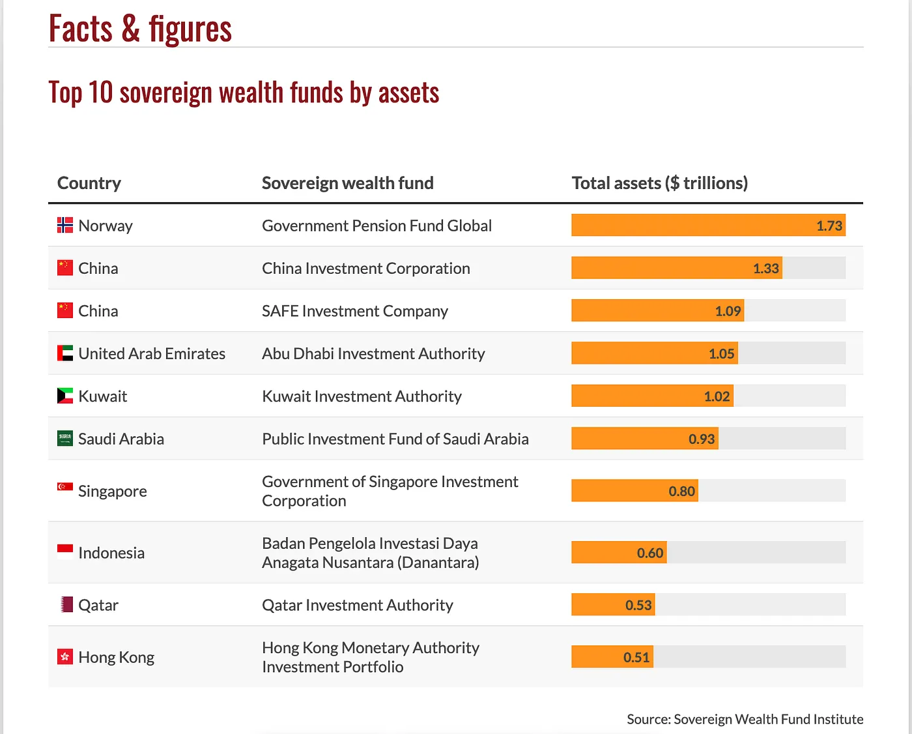

With the U.S. government now taking a 10% stake in Intel, talk of a sovereign wealth fund (SWF) in Washington, and myself currently living here in Singapore where Temasek and state linked companies are part of everyday life, I figured there’s no better time to explore what state capitalism and sovereign wealth funds are.

State capitalism is an economic system where the government plays a strong role in directing or owning parts of the economy but the underlying market incentives stay the same. Instead of being purely socialist (where the state controls everything for redistribution) or purely capitalist (where private actors dominate), the state acts like a corporate owner/investor. Furthermore, the idea of a Sovereign Wealth Fund (SWF) is to act as a state owned investment fund to manage national savings and invest in global assets with the goal to preserve and grow national wealth.

State capitalism looks different around the world and it's not always implemented through an SWF; the Intel stake in the U.S. for example is a direct equity position (for now at least). In Singapore, Temasek and GIC manage hundreds of billions across airlines, telecoms, and banks. In China, state owned enterprises (SOE) are common in industries from energy to finance while still competing globally (to a certain extent). Norway’s oil backed sovereign wealth fund channels natural resource revenues into investments that benefit future generations. Meanwhile, countries like Saudi Arabia (via PIF) and the UAE (via Mubadala, ADIA) use SWFs to diversify away from oil and build global economic influence.

# Past and Present of State Capitalism & SWFs

## History in the USA

In the U.S., state capitalism and SWFs have historically been either non-existent or used only in specific circumstances. Most of the times the U.S. government has taken control of, or a stake in, the private sector fall into two main categories: war and recession. Below are three of the most notable examples.

First, in the 1930s during the Great Depression, the government created government owned corporations like Tennessee Valley Authority (TVA) to build dams, electricity, and stimulate economic development. At the time, private markets weren't willing to finance massive rural electrification projects leading to the state stepping in. Today, the TVA still exists as one of the largest publicly owned utilities in the U.S. 

The next time we saw something like this in the States was in the 1940s-1960s. During WW2 the government directed huge parts of industry, building and financing factories and controlling the production of everything from steel to ships. During the Cold War, agencies like DARPA functioned as state funders of private innovation in semiconductors, computing, and the internet. You could argue that today's biggest tech sectors owe their roots to state directed funding in things like DARPA.

Finally, the most recent major example before the new Intel deal came during the 2008 Financial Crisis (TARP bailouts). Through the Troubled Asset Relief Program (TARP), Washington injected capital into banks and automakers, in some cases taking direct equity stakes. The U.S. became a temporary shareholder in GM, Chrysler, AIG, and major banks. When all was said and done, most shares were sold back. Taxpayers ultimately lost about $11B on GM but made profits on banks. 

As for SWFs, the U.S. has never had a national one; at most we have seen proposals and partial attempts. The closest thing is the Alaska Permanent Fund, which started in 1976. The state of Alaska started the fund to save and invest oil wealth for future generations and distribute a yearly dividend to residents. The fund has grown to ~$80B+ AUM. It’s the closest thing the U.S. has to an SWF, but at a state level rather than national. 

## Experience Globally

Globally it's another story; SWFs and state capitalism can be seen around the world. In the Gulf, countries like Kuwait, UAE, Saudi Arabia, and Qatar each have their own SWFs with ~$500B-1T+ AUM with stakes in global brands and hopes of diversifying out of oil. In China it is common for SOEs to dominate major industries like energy, space, telecom, finance, and transportation giving the government more control and planning capabilities. China also has its own SWF with ~$1.3T AUM which invests globally but less so than others. Singapore essentially runs two different SWFs: Temasek acts as a holding company managing stakes in domestic companies as well as global investments, while GIC manages Singapore's foreign reserves, investing globally. In Canada, there are surprisingly SWF-like funds in the form of large public pension plans. The Canada Pension Plan Investment Board (CPPIB) alone manages ~C$700B, and others like the Ontario Teachers' Pension Plan (OTPP) are famous for investing much like sovereign funds, although they invest on behalf of pensioners rather than the state. Finally, perhaps the most successful SWF of all is Norway's Government Pension Fund Global (GPFG). The GPFG invests exclusively abroad in various assets and excludes domestic firms to avoid overheating the local economy. The GPFG has ~$1.9T AUM, making it the largest SWF in the world, while also excluding investments in tobacco, certain weapons makers, and serious environmental violators.

# What's Happening Today

The U.S. government’s 10% stake in Intel, announced in August 2025, marks a new era of government investment. Unlike past bailouts where Washington acted as a temporary rescuer, this move was structured as a direct equity position putting the U.S. government in the unusual position of being Intel’s single largest shareholder, although it has no board seats and has agreed to vote alongside Intel’s board on most shareholder matters.

The deal essentially converts ~$8.9B in previously awarded but unpaid grants from the CHIPS Act and the Secure Enclave program into newly issued Intel shares. Intel has been struggling for years. Once the leader in microprocessors, it has been losing ground to Taiwan’s TSMC, Nvidia, and even AMD. Billions in losses, layoffs, and missed technology roadmaps have raised questions about its future. The issue is that now more than ever, semiconductors are seen as a matter of national security that shapes AI, defense, and supply chains. 

# Future Outlook 

Although Intel is one of only a handful of positions so far (alongside a Department of Defense stake in rare earths miner MP Materials), it seems likely that this is the beginning of a new economic strategy for America. For decades, the US has been the epicentre of free markets and laissez-faire economics. This leads to a blurry line for what role the U.S. will play in the future of American companies. Will they be a regulator or owner? Will they eventually push for influence and voting rights? It becomes a dangerous game very quickly that could both greatly benefit Americans or hurt them. 

Trump has also been pursuing a SWF, signing an executive order in early 2025 directing a plan for one. If a U.S. SWF is created, there are essentially two possible models. The first would be Norway/Gulf style, investing globally in various assets using profits to strengthen national finances and benefit future generations. Given that this strategy requires the government to consistently run a surplus or have large natural resource reserves, this seems unlikely. The more likely model for the U.S. to follow is that of Temasek in Singapore, an active investment company holding significant stakes in key domestic and global companies across strategic sectors. 

The next question is how, in practice, the U.S. would fund a SWF. The U.S. doesn’t have a resource windfall like Norway or Saudi Arabia, nor does it run a budget surplus (even if it did it has a deficit to pay off), so the options are different. The most likely option would be a reallocation of subsidies, grants, and policy funds (similar to the Intel case). Quite frankly this seems like the only realistic option as we have pointed out earlier the other popular options aren't viable here.

The US currently spends very roughly ~$3T on a mix of subsidies, grants, and tax expenditures. Even redirecting a modest share of this each year, say 5% (~$150B), would make it one of the largest funds in the world within a decade. Once the SWF is formed and funds are being allocated a rough idea of what it could look like is the following: 
- Structure: Created as an independent government-owned corporation (like CPPIB in Canada or Temasek in Singapore).
- Governance: Non-political professional managers, reporting to Congress but insulated from daily politics.
- Mandate:
  - Invest in strategic U.S. industries (semiconductors, AI, clean energy).
  - Allocate globally for diversification.
  - Provide returns that either fund the budget or reduce debt.

There is no guarantee this comes to fruition, but there are obviously many risks as well as potential benefits to come from a U.S. SWF and shift to a state capitalism style economy. Whether it is a good idea is in the eye of the beholder, perhaps a good exercise is to do a Veil of Ignorance Test:
- Behind veil: you don’t know if you’ll be rich/poor, powerful/powerless.
- Would you prefer an America with or without SWF and State Capitalism?